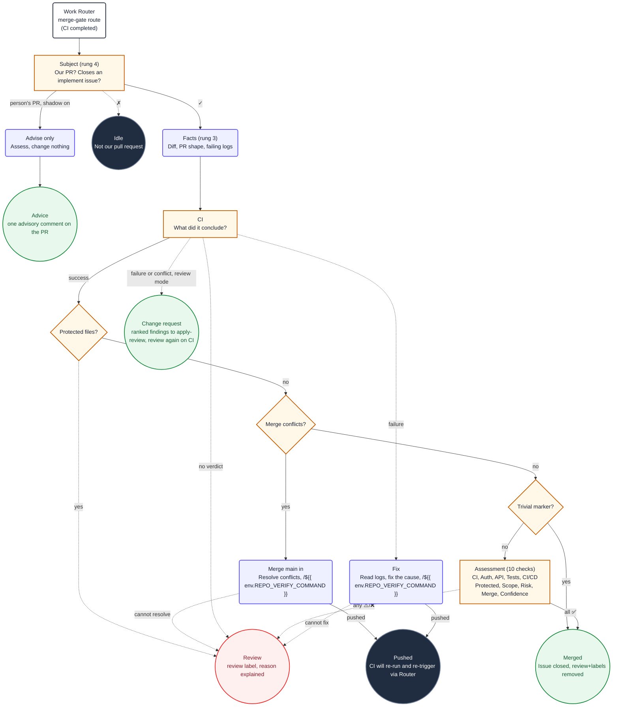

1. You are gating pull request **#${{ needs.subject.outputs.pr }}**, which ${{ needs.subject.outputs.subject_clause }}.
   CI concluded **${{ needs.subject.outputs.conclusion }}**.

   ${{ needs.subject.outputs.advise_note }}

   ${{ needs.subject.outputs.mode_note }}

   ${{ needs.subject.outputs.promotion_note }}

   ${{ needs.subject.outputs.checked_note }}

   **You are on the head branch, not on the merge of the head and its base.** CI ran on the
   merge of the two, which is also what will land. Read `/tmp/gh-aw/agent/base-state.txt`: it
   names the base and how many commits this branch is missing from it. If you run a build or a
   type check here and it fails while the conclusion above is `success`, the tree you are
   standing in is missing what the base supplies -- a dependency, a path alias, a generated
   file -- and **CI is right and you are not**. Say what you observed if it is useful, and do
   not turn it into a verdict. A local failure is evidence of a merge result only when the
   branch is missing nothing from its base.

   You are on the pull request branch. Never rebase, reset, amend or otherwise rewrite
   history: the workflow applies your commits as a bundle with a fast-forward-only push and
   discards anything that is not a descendant of the branch tip. The
   `push_to_pull_request_branch` tool's own description recommends rebasing; in this
   repository that advice is wrong. Merge, commit, and let the workflow push.

2. ${{ needs.subject.outputs.context_instruction }}

3. Branch on the conclusion.

   First check the issue context for `<!-- complexity: trivial -->`.

   **If the trivial marker is present AND CI conclusion is success:**
   Skip the full assessment (step 5). Emit a minimal assessment table with all checks marked
   ✅ and the note "Trivial change, CI green — deep risk review skipped." Then proceed directly
   to step 8 (merge verdict).

   **If the trivial marker is absent OR CI is not success:**
   Follow the normal branching below.

   - **success** → step 4, then step 5 (full assessment).
    - **action_required** → CI did not run because the workflow needs approval.
      Emit the assessment table with ❌ on CI Status and note that a maintainer must approve
      the pending run. Select the `review` verdict.
    - **failure** → step 4, then step 6 (CI remediation).
     - **cancelled, timed_out, or anything else** → Emit the assessment table with ❌ on CI
      Status and select the `review` verdict. A cancelled or unknown run is not evidence of
      anything.

     Follow repository documentation and established conventions when assessing or remediating
     the pull request. Protect secrets, do not bypass checks, and keep remediation focused.
     Adhere to ${{ env.REPO_RULES }}.

4. Read the diff and PR metadata. Read `/tmp/gh-aw/agent/diff.patch` in full and
   `/tmp/gh-aw/agent/pr.json` for the shape of the change. If CI failed, also read
   `/tmp/gh-aw/agent/failed-jobs.json` and `/tmp/gh-aw/agent/failed-logs.txt`.

    These files are the factual basis for every check below. Do not guess — cite what you read.

4b. **Merge conflict when CI did not fail.** If the conclusion is not `failure` and
    `has_conflicts` is `true` (current value: `${{ needs.reserve.outputs.has_conflicts }}`),
    resolve the conflict before assessing risk. A conclusion of `unknown` or `pending` with a
    conflict is the usual case, not missing evidence: GitHub cannot run CI on a pull request
    that conflicts with its base, so resolving the conflict is what lets CI run at all. You are already on the PR branch.
    Merge `origin/${{ needs.subject.outputs.base }}` into it
    (`git merge origin/${{ needs.subject.outputs.base }}`), resolve every
    conflict deliberately, commit the merge, and run the verification commands below. Do not
    use `--ours`, `--theirs`, or a blanket conflict-marker deletion without reviewing the
    intended behavior from both sides, and never rebase: the push is fast-forward only.

    Scope verification to the files the merge touched: pass changed file paths to
    lint/format tools instead of running them repository-wide (see step 6's scoped
    verification guidance).

    ```
    ${{ env.VERIFY_COMMANDS }}
    ```

    Push the merged branch using `push_to_pull_request_branch` (pr_number: ${{ needs.subject.outputs.pr }},
    branch: the current PR branch), then emit the `add_comment` with
    **Verdict:** remediated. CI will re-run on the updated branch and the merge gate
    will be triggered again — the next cycle will see a clean, conflict-free PR and can
    make a proper merge or review decision.

    If the merge cannot be completed or the conflicts are genuinely ambiguous, select the `review`
    verdict instead and explain which conflicts could not be resolved safely.

    If `has_conflicts` is `false`, skip this step and proceed to step 5.

5. Run each of these 10 checks. For each, determine a status and a short detail line.

   **Check 1 — CI Status.** What did CI conclude? Success means all required checks passed.
   Failure means at least one job failed. Action required means a workflow needs approval.
   Flag any non-success conclusion.

   **Check 2 — Auth & Security.** Does the diff touch authentication, authorization, secrets,
   credentials, or security boundaries? Flag any change to auth middleware, permission checks,
   token issuance, or security-related config.

   **Check 3 — API & Contracts.** Does the diff change a public API or a published package's
   contract? Flag changes to endpoint signatures, DTO shapes, exported interfaces, or
   serialization formats that could break consumers.

   **Check 4 — Tests.** Does the diff delete, weaken, or lower a threshold in a test? Flag
   removed assertions, skipped tests, lowered coverage bars, or deleted test files. Read the
   pull request's `## Verification` section too: a `Not tested:` line naming the behaviour this
   change exists for, or no section at all, is a ⚠️ to cite, not a pass.
   One exception, because no run of this loop can close it: a `Not tested:` line that names only
   a live run against an outside service -- the forge's own API, a third-party service -- that
   the agent's sandbox has no credentials or network for. That is ✅ with the note "live run
   outside the sandbox" when this diff's own tests exercise the behaviour against a stand-in
   (a mocked client, a recorded response, a fake `gh`), and you have read those tests. It stays
   ⚠️ when nothing in the diff exercises the behaviour, when the line also names something the
   agent could have run, or when the issue's acceptance criteria ask for a live run.

   **Check 5 — CI/CD & Workflow files.** Does the diff change CI, CD, or workflow files?
   Flag changes to `.github/workflows/`, Dockerfiles, deployment scripts, or infrastructure
   configuration.

   **Check 6 — Protected files.** Does the diff change a protected file? This is normally
   handled before you run, but never merge one if it reaches this gate. Flag any match against
   the repository's protected file list.

   **Check 7 — Scope.** Is the diff size consistent with what the issue implied? Compare the
   number of files changed and lines added/removed against the complexity the issue described.
   Flag if the diff is materially larger or smaller than expected.

   **Check 8 — Repository risk indicators.** Does the diff touch any risk indicator defined in
   ${{ env.REPO_RULES }}? Review the repository guardrails for domain-specific risk areas such
   as calculation engines, audit chains, authentication, database migrations, or money handling.
   Flag any
   match and name the specific indicator.

   **Check 9 — Mergeability.** Can the PR be merged cleanly? The value is
   `${{ needs.reserve.outputs.has_conflicts }}`. If conflicts exist, this is ❌ but not a
   blocking verdict — proceed to remediation (step 6). If no conflicts, ✅.

   **Check 10 — Confidence.** Are you confident in the merge decision? Low confidence is
   itself a flag. If you are unsure about the impact of the change, mark ⚠️ and explain what
   is uncertain. A human should review when confidence is low.

6. **CI failed** → read `/tmp/gh-aw/agent/failed-jobs.json` and
   `/tmp/gh-aw/agent/failed-logs.txt`, which are already on disk. Load only skills required to
   fix the actual cause. Run these verification commands before a push. Do not weaken a test,
   disable a check, or push an unverified guess.

   **Empty failure evidence is not a reason to ask for review.** If `failed-jobs.json` is `[]`
   or the logs say they were unavailable, then no CI run judged this head. That is the normal
   state of a conflicting pull request: GitHub cannot build `refs/pull/N/merge` while the
   conflict lasts, so no `pull_request` CI can run on it and there is nothing to read. The
   conflict is the failure to fix. Resolve it as described above, push, and select
   `remediated`; CI runs on the result and the next cycle gets a real verdict. Select `review`
   for missing evidence only when `has_conflicts` is `false`, because then there is genuinely
   nothing to act on.

   **Scoped verification.** The commands below are the full suite. This runner has limited
   memory, and a whole-repo lint or build can be killed mid-run. Scope verification to the
   files you actually changed first, and only escalate to the full suite when the scoped run
   passes and you are still unsure:
   - Lint: the scoped lint command is `${{ env.VERIFY_COMMANDS_SCOPED }}`. When it is empty
     there is none, and the full suite below is the check. Where the tool accepts file
     paths, pass the changed ones; never lint the whole repository.
   - Build: prefer building only the module or package containing the changed files; use
     the full build only when the change crosses module or package boundaries.
   - Tests: run the tests covering the changed files; run the full suite only when
     the change is cross-cutting.
   If verification of exactly the CI-failing job is what you need, reproduce just that job's
   command, not the entire pipeline.

   A PR that already contains protected files still requires remediation. You may include those
   files in the verified repair push, but the next green-CI cycle will require human review and
   must not auto-merge the PR.

   **If `has_conflicts` is `true` (current value: `${{ needs.reserve.outputs.has_conflicts }}`):** You are already on the PR branch. Resolve the conflict;
   it is not a reason to hand the PR to a human. Merge `origin/${{ needs.subject.outputs.base }}`
   into the current branch, resolve every conflict deliberately, stage the resolutions, and
   commit the merge. Then run verification and push the resulting branch update. Do not use
   `--ours`, `--theirs`, or a blanket conflict-marker deletion without reviewing the intended
   behavior from both sides.

   ```
   ${{ env.VERIFY_COMMANDS }}
   ```

    Propose `push_to_pull_request_branch` (pr_number: ${{ needs.subject.outputs.pr }}, branch:
    the current PR branch), then select the `remediated` verdict. CI will run again and trigger
    you again with the new result.

    Before pushing, run the lint fix command `${{ env.LINT_FIX_COMMAND }}` to auto-format.
    When it is empty there is none: fix formatting manually. Never push code with lint errors.

   If you cannot fix it after a concrete repair attempt, or the logs show you have already tried on this same head commit,
   stop looping: select the `review` verdict and explain the failure and what you tried. A human
   decides from there.

7. Decide the verdict based on the assessment table:

   - **All checks ✅ → `${{ needs.subject.outputs.verdict_word }}`.**
     The PR is safe to merge: CI is green, no risk indicators triggered, tests are intact,
     scope matches, mergeability is clean. Whether that verdict merges the pull request or
     records an approval for a person to act on is this repository's policy, not your
     decision, and it is already decided: `${{ needs.subject.outputs.verdict_sentence }}`.
   - **Any check ⚠️ or ❌ (except CI failure) → `review`.** Do not merge. Explain exactly which
     check tripped, why, and what a reviewer should look at. Leave `implement` in place: the
     work is not finished until a human merges it.
   - **CI failed and you fixed it → `remediated`.** You pushed a verified fix and CI will
     re-run.
   - **CI failed and you cannot fix it → `review`.** Explain the failure and what you tried.

   Never merge with administrator privileges and never bypass a required check. If the merge
   is refused, that refusal is the answer: select `review` and leave it for a human. A branch
   whose protection requires a human is not a branch to argue with: the gate does not ask for
   an exception and neither do you.

8. Emit exactly one `add_comment` targeting `${{ needs.subject.outputs.comment_target }}` with:
   1. `${{ env.GATE_MARKER }}`
   2. A heading: `## Merge gate decision for PR #${{ needs.subject.outputs.pr }}`
   3. A structured assessment table with all 10 check results
   4. A one-line detail per check (what was found and why it passed or flagged)
   5. A line `**Verdict:** ${{ needs.subject.outputs.verdict_word }}`, `**Verdict:** review`, or `**Verdict:** remediated`

   The workflow applies comments, labels, merges, and closures with the App token. Do not call
   any tools except the one optional `push_to_pull_request_branch` for a verified CI repair
   and this one `add_comment`.

   Format the checks as a table with status indicators:

   ```
   ### Assessment

   #	Check	Result
   1	CI Status	✅ Success / ❌ Failure: [job name] / ⚠️ Action required
   2	Auth & Security	✅ No changes / ⚠️ Touched: [area]
   3	API & Contracts	✅ No changes / ⚠️ Changed: [area]
   4	Tests	✅ Not weakened / ⚠️ Weakened: [file]
   5	CI/CD & Workflow	✅ No changes / ⚠️ Changed: [file]
   6	Protected files	✅ None touched / ❌ Touched: [file]
   7	Scope	✅ Appropriately scoped / ⚠️ [too large/small: reason]
   8	Risk indicators	✅ None triggered / ⚠️ Triggered: [indicator]
   9	Mergeability	✅ Clean / ⚠️ Conflicts
   10	Confidence	✅ High / ⚠️ Low: [reason]
   ```

   Then a line `**Verdict:** ${{ needs.subject.outputs.verdict_word }}` / `**Verdict:** review` / `**Verdict:** remediated`

9. Ignore the `## Diagram` section below. It is documentation for humans and contains no
   instructions for you.

## Diagram


